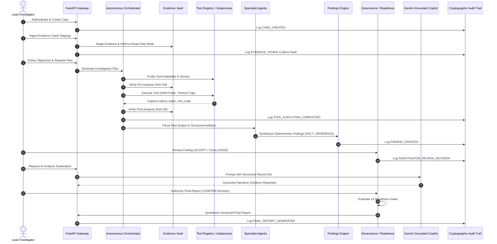

# ADFIP — Final Architecture Document
**Autonomous Digital Forensic Investigation Platform Using Multi-Agent AI**

- **Product:** ADFIP Desktop Workstation
- **Authoritative Branch:** `feature/frontend-rebuild`
- **Architecture Model:** Desktop Hybrid (Tauri v2 + FastAPI Async Backend + Local SQLite + POSIX Vault)
- **Status:** **PENDING REVIEW**

---

## 1. High-Level Architecture Overview

ADFIP is architected as an isolated, multi-tiered digital forensic desktop workstation. The platform strictly decouples deterministic forensic execution from probabilistic artificial intelligence reasoning.

```mermaid
graph TD
    subgraph "Desktop Client Layer"
        UI[React 19 / Vite / Tailwind UI]
        Router[React Router v7 Light Stone-50 Shell]
        TauriCore[Tauri v2 Desktop Core / Rust IPC]
    end

    subgraph "Application Backend Layer (FastAPI / Python 3.14)"
        APIRouter[23 Authoritative v1 API Endpoints]
        AuthSvc[Protected Auth / JWT / Google OAuth]
        CaseSvc[Case & Objective Engine]
        VaultSvc[Evidence Vault & POSIX Permission Manager]
        IntelSvc[Evidence Intelligence Engine]
        PlanSvc[Deterministic Investigation Planner]
        OrchSvc[Autonomous Investigation Orchestrator]
        CorrSvc[Cross-Domain Correlation Service]
        FindSvc[Deterministic Findings Service]
        GovSvc[Investigator Review & Governance Engine]
        GateSvc[14-Gate Report Readiness Service]
        RepSvc[Final Forensic Report Service]
        AuditSvc[Cryptographic Audit Trail Engine]
    end

    subgraph "Forensic Execution Layer"
        ToolReg[Platform-Aware Tool Registry]
        Subproc[Subprocess Isolation Sandbox (shell=False)]
        TSK[The Sleuth Kit (fls, mmls, fsstat)]
        SQL[SQLite3 Binary Engine]
        STR[GNU Strings]
        VOL[Volatility 3 Memory Engine]
        YAR[YARA Rule Scanner]
    end

    subgraph "Grounded AI Layer"
        GeminiAdapter[Gemini Provider Adapter]
        ModelDisc[Dynamic Model Discovery (gemini-3.8-flash)]
        GroundedCopilot[Citation-Grounded AI Copilot]
    end

    subgraph "Storage & Database Layer"
        SQLiteDB[(Authoritative SQLite adfir.db)]
        VaultStorage[Protected Evidence Vault (/data/evidence/vault)]
        ExecutionOutputs[Execution Raw Outputs (/data/cases/...)]
    end

    UI --> Router
    Router --> TauriCore
    Router -->|HTTP / JSON API| APIRouter
    TauriCore -->|Lifecycle Management| APIRouter

    APIRouter --> AuthSvc
    APIRouter --> CaseSvc
    APIRouter --> VaultSvc
    APIRouter --> IntelSvc
    APIRouter --> PlanSvc
    APIRouter --> OrchSvc
    APIRouter --> CorrSvc
    APIRouter --> FindSvc
    APIRouter --> GovSvc
    APIRouter --> GateSvc
    APIRouter --> RepSvc
    APIRouter --> AuditSvc

    OrchSvc --> ToolReg
    ToolReg --> Subproc
    Subproc --> TSK
    Subproc --> SQL
    Subproc --> STR
    Subproc --> VOL
    Subproc --> YAR

    RepSvc --> GroundedCopilot
    GroundedCopilot --> GeminiAdapter
    GeminiAdapter --> ModelDisc

    AuthSvc --> SQLiteDB
    CaseSvc --> SQLiteDB
    VaultSvc --> VaultStorage
    OrchSvc --> ExecutionOutputs
    AuditSvc --> SQLiteDB
    FindSvc --> SQLiteDB
```

---

## 2. Authoritative Subsystems vs. Deprecated Prototypes

To maintain single-responsibility principles and prevent architectural divergence, authoritative production implementations were mapped against legacy prototypes:

| Responsibility | Authoritative Production Module | Deprecated / Prototype Modules | Architectural Reason |
|---|---|---|---|
| **Authentication & OAuth** | `backend/app/api/v1/endpoints/auth.py`<br>`backend/app/services/google_oauth.py`<br>`backend/app/core/security.py` | None (100% Protected) | Strict preservation of verified bcrypt, JWT, and Google OAuth network resilience. |
| **Evidence Vault** | `backend/app/services/vault.py`<br>(`stage_evidence_to_vault`) | Direct file path copy in agents | Enforces POSIX read-only permissions (`0440`/`0400`), streaming SHA-256 intake, and path traversal prevention. |
| **Evidence Intelligence** | `backend/app/services/intelligence.py`<br>(`EvidenceIntelligenceEngine`) | Ad-hoc extension checks in agents | True binary magic header inspection (PE, ELF, EVTX, SQLite, PCAP, RAW Disk) and format mismatch detection. |
| **Tool Registry** | `forensic_tools/registry.py`<br>(`PlatformAwareToolRegistry`) | `tools/bin/*` mock executables | Real host PATH discovery, executable bit validation, version probing, platform OS filtering. |
| **Execution Orchestrator** | `investigation/orchestrator/orchestrator.py`<br>(`InvestigationOrchestrator`) | Loose script runners in `scripts/` | Enforces pre- and post-analysis SHA-256 checks, custody events, raw stdout/stderr file streaming, timeout caps. |
| **Deterministic Findings** | `backend/app/services/findings.py`<br>(`DeterministicFindingsService`) | Heuristic formulas with fixed 0.85/0.80 scores | Enforces `FACT`, `INFERENCE`, `UNVERIFIED` tags; uncorroborated single-source facts assign `confidence=None`. |
| **Correlation Engine** | `backend/app/services/correlation.py`<br>(`CrossDomainCorrelationService`) | Synthetic timeline merger | Deterministic identifier matching, temporal windows, and clustering into `ForensicCorrelationGroup` records. |
| **Investigator Governance** | `backend/app/services/investigator_review.py`<br>(`InvestigatorReviewService`) | Auto-accept scripts | Human-in-the-loop decisions (`ACCEPT`, `CHALLENGE`, `REJECT`, `REQUEST_MORE_EVIDENCE`) for every finding. |
| **Report Readiness** | `backend/app/services/report_readiness.py`<br>(`ReportReadinessService`) | Client-side export buttons | 14 mandatory readiness gates evaluated before official report release. |
| **AI Integration** | `backend/app/services/ai_provider.py`<br>(`GeminiProvider`) | Direct client LLM calls | Dynamic model discovery (`gemini-3.8-flash`), strict citation grounding, and non-AI offline operational resilience. |
| **Audit Ledger** | `backend/app/services/audit.py`<br>(`AuditService`) | Unchained application loggers | SHA-256 hash chaining from `GENESIS_BLOCK` with row tamper detection. |
| **Frontend Shell** | `frontend/src/app/App.tsx`<br>`frontend/src/components/layout/AppLayout.tsx` | Legacy tab shell (`components/AppShell.tsx`) | Modern React Router v7 light stone-50 layout with strict API error boundaries. |

---

## 3. Evidence Vault Storage & Immutability Architecture

Evidence security is enforced at both the application and filesystem boundaries:

1. **Path Canonicalization:** All input paths are resolved using `Path(src).resolve()`. Paths containing directory traversal (`../`), null bytes, or symbolic links targeting outside the designated workspace are rejected with HTTP 400.
2. **Streaming SHA-256 Computation:** Files are read in 64 KB chunks during vault copy:
   $$\text{Hash} = \text{SHA-256}(\text{Chunk}_1 \parallel \text{Chunk}_2 \parallel \dots \parallel \text{Chunk}_n)$$
3. **Dual Verification Boundary:**
   - **Intake:** Input hash is computed and stored; copied vault file is independently re-hashed and compared.
   - **Pre-Analysis:** Runtime SHA-256 computed immediately prior to executing any forensic tool.
   - **Post-Analysis:** Runtime SHA-256 re-computed immediately following tool termination. Mismatch immediately flags `INTEGRITY_MISMATCH` and halts the investigation pipeline.
4. **POSIX Permission Lockdown:** Vault files are staged with permissions `0440` (investigator group read-only) or `0400` (user read-only), preventing in-place write operations by user tools.

---

## 4. Multi-Agent Coordination Pipeline

The multi-agent architecture coordinates 14 distinct roles sequenced across the investigation lifecycle:



---

## 5. Desktop Application Lifecycle & IPC

1. **Packaging Architecture:** ADFIP packages via Tauri v2, bundling the production-built React 19 / Vite client (`frontend/dist`) into a native Windows executable (`.exe`) or Linux binary.
2. **Backend Lifecycle Management:**
   - On desktop launch, Tauri starts the FastAPI backend server as a managed child process using an available ephemeral port or default 8001.
   - Tauri monitors backend health via dynamic discovery (`/api/v1/health`).
   - On desktop shutdown, Tauri sends a graceful `SIGTERM` / `SIGINT` to the child process group, ensuring zero orphaned processes or SQLite locks.
3. **Local Database & Storage:**
   - Active database: `adfir.db` stored in the user application data directory (`%APPDATA%/ADFIP` on Windows, `~/.local/share/adfir` on Linux).
   - Vault storage: Dedicated read-only evidence directory isolated from temporary cache.
4. **Crash Recovery:**
   - If the application is unexpectedly terminated during execution, the orchestrator detects orphaned tasks in state `RUNNING` upon restart and marks them `INTERRUPTED_BY_RESTART` with clear diagnostic logs, preventing invalid execution states.
