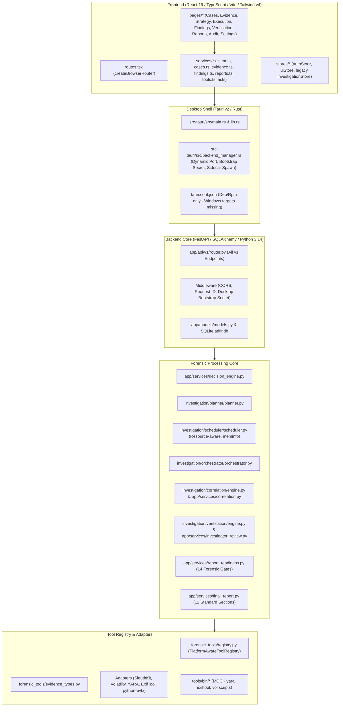

# ADFIP — PHASE 0: COMPLETE ENGINEERING, FORENSIC REALITY & PRODUCTION READINESS AUDIT

**Target Repository:** `/home/nandireddy/ADFIP-1`  
**Authoritative Branch:** `feature/frontend-rebuild`  
**Audit Timestamp:** 2026-11-08  
**Audit Role:** Principal Software Architect, Senior Digital Forensics Engineer, Backend Engineer, Frontend Engineer, Security Auditor & Windows Desktop Release Engineer  
**Status:** COMPLETE (AUDIT-FIRST — ZERO APPLICATION SOURCE CODE MODIFIED)

---

## 1. EXECUTIVE SUMMARY

An exhaustive, forensic reality and production readiness audit of the **ADFIP** (Autonomous Digital Forensic Investigation Platform) codebase was performed on the authoritative branch `feature/frontend-rebuild`.

ADFIP contains significant, well-engineered architectural layers, including cryptographically sound evidence vaulting, streaming SHA-256 chunk hashing, immutable chain of custody tracking, an explicit 14-gate forensic report readiness evaluation subsystem, a 12-section standardized report generator, and a governed AI reasoning layer. However, the platform currently suffers from **critical engineering defects, fake tool executions, architectural gaps, and desktop packaging blockers** that prevent it from functioning as a genuine, legally defensible digital forensics desktop application.

### Key Audit Findings:
1. **Mock Forensic Executables Impersonating Real Binaries:** Real `yara`, `exiftool`, and `volatility3` are **not installed** on the host. Instead, the application bundles and executes Python mock scripts located in `tools/bin/` and `volatility-env/bin/` that generate canned, hardcoded outputs (e.g., hardcoded `powershell.exe` and `10.0.0.15` in `tools/bin/vol`). The tool registry (`PlatformAwareToolRegistry`) discovers these mock wrappers first and reports `is_available = True`, misleading investigators and producing fabricated execution records.
2. **The Observed YARA Problem Root Cause:** When an investigator adds a YARA rule file, `InvestigationPlanner` incorrectly classifies `"yara_rule"` as scannable malware target evidence and schedules `MalwareAgent` to execute `YARA` against the rule file itself (`yara -s <rule> <rule>`). `MalwareAgent` rejects this because `YARA_RULE` has role `EvidenceRole.RULE_RESOURCE` rather than `TARGET_EVIDENCE`, failing with `Evidence type 'YARA_RULE' is not supported by MalwareAgent.` A detection rule must never be treated as malware target evidence.
3. **Defaulting Unavailable Tools to Available:** In `investigation/orchestrator/orchestrator.py` (lines 94 & 741), tasks without an explicit `tool_available` flag unconditionally default to `tool_available = True` without verifying host tool availability against `PlatformAwareToolRegistry`. This allows tasks with missing binaries to proceed into execution.
4. **Desktop Memory Exhaustion / OOM Vulnerability:** In Tauri, `select_evidence_file` and `read_evidence_file` (Rust `std::fs::read(&path)`) load the entire binary evidence file into memory as a `Vec<u8>`, serialize it over Tauri IPC into JavaScript `Uint8Array`, and attempt an in-memory HTTP FormData multipart upload. Attempting to open any standard disk or memory image (>2 GB) will instantly crash the WebView2 process with Out-Of-Memory.
5. **Windows Desktop & Microsoft Store Blockers:** Tauri bundle targets in `tauri.conf.json` are strictly set to `["deb", "rpm"]` with zero Windows packaging (`msi`, `nsis`, `appx`). `adfir-backend.spec` lacks hidden imports for over 14 newly developed services and investigation modules. `dist/adfir-backend` is empty, causing all 9 PyInstaller and desktop lifecycle tests to be skipped.
6. **Frontend Split & Missing Pages:** The repository contains orphaned legacy pages (`frontend/src/pages/*.tsx`) and an active new routing system (`frontend/src/app/routes.tsx`). The new router has completely disconnected or omitted:
   - Interactive Forensic AI Copilot Workstation (`AIAnalysisPage.tsx`).
   - Unified Forensic Timeline viewer.
   - Artifact & Normalized Artifact browser.
   - Dedicated cross-domain correlation viewer.
7. **Code Defects in Specialist Agents:** A Python literal string concatenation bug in `agents/log/log_agent.py` combines `"document"` and `"log"` into `"documentlog"`, dropping document handling. A duplicate return in `agents/memory/memory_agent.py` makes `minidump` handling unreachable. Hardcoded confidence scores (0.90, 0.95) exist across several specialist agents without statistical backing.

---

## 2. CURRENT BRANCH AND GIT STATE

- **Current Branch:** `feature/frontend-rebuild`
- **Upstream Status:** Up to date with `origin/feature/frontend-rebuild`
- **Working Tree:** Clean (no uncommitted modifications, no staged changes)
- **Authentication Protection:** Strict compliance verified. Authentication endpoints, Google OAuth flows, JWT security, password hashing, and user authentication tables remain completely unmodified.

---

## 3. REPOSITORY ARCHITECTURE



---

## 4. COMPLETE WORKFLOW TRACE (STEPS 1 – 29)

Below is the exhaustive trace of all 29 forensic investigation steps across the ADFIP stack:

| Step # | Workflow Step | Frontend Component | Frontend API Function | Backend Endpoint | Backend Service | Database Model / Table | Tool Adapter / Agent | Persisted Data | Test Reference | Disconnected / Defect Status |
|---|---|---|---|---|---|---|---|---|---|---|
| **1** | Case Creation | `CasesPage.tsx`, `CreateCaseDialog` | `casesService.create` | `POST /api/v1/cases` | `CaseService` / `cases.py` | `Case`, `CaseMember` | N/A | Case ID, number, title, owner | `test_case_creation_workflow.py` | REAL_AND_CONNECTED |
| **2** | Evidence Intake | `EvidencePage.tsx`, `AddEvidenceDialog` | `evidenceService.intake` | `POST /api/v1/cases/{id}/evidence/intake` | `EvidenceVaultService`, `acquisition.py` | `EvidenceItem` | N/A | File name, original path, evidence type | `test_evidence_acquisition_workflow.py` | PARTIALLY_CONNECTED (OOM on desktop when reading file bytes into browser memory) |
| **3** | Evidence Validation | `EvidenceDetailPage.tsx` | `evidenceService.verify` | `POST /api/v1/evidence/{id}/verify` | `vault.py`, `integrity.py` | `EvidenceItem` | N/A | `integrity_status` ('VERIFIED' / 'FAILED') | `test_evidence_vault.py` | REAL_AND_CONNECTED |
| **4** | Evidence Hashing | `EvidencePage.tsx` | N/A (Backend synchronous) | `POST /api/v1/cases/{id}/evidence/intake` | `integrity.py:calculate_sha256` | `EvidenceItem.sha256` | N/A | Streaming SHA-256 (8MB chunks) | `test_integrity.py` | REAL_AND_CONNECTED |
| **5** | Evidence Vault Storage | `EvidenceDetailPage.tsx` | N/A (Backend synchronous) | `POST /api/v1/cases/{id}/evidence/intake` | `vault.py:stage_evidence_to_vault` | `EvidenceItem.storage_path` | N/A | Preserved read-only copy in `EVIDENCE_DIR/vault/` | `test_evidence_vault.py` | REAL_AND_CONNECTED |
| **6** | Chain of Custody | `ChainOfCustodyTimeline.tsx` | `evidenceService.getCustody` | `GET /api/v1/evidence/{id}/custody` | `custody.py` | `ChainOfCustodyEvent` | N/A | Custody event record with actor, timestamp, hash snapshot | `test_evidence_acquisition_pipeline.py` | REAL_AND_CONNECTED |
| **7** | Evidence Intelligence | `IntelligencePage.tsx` | `evidenceService.extractIntelligence` | `POST /api/v1/evidence/{id}/intelligence` | `intelligence.py` | `EvidenceIntelligence` | N/A | MIME, magic signature, entropy, partitions, tags | `test_evidence_intelligence_subsystem.py` | REAL_AND_CONNECTED |
| **8** | Objective Processing | `CaseOverviewPage.tsx` | `casesService.updateObjective` | `PATCH /api/v1/cases/{id}` | `decision_engine.py` | `Case.objective_archetype` | N/A | Archetype enum (e.g. `MALWARE_INFECTION`, `UNAUTHORIZED_ACCESS`) | `test_decision_engine.py` | REAL_AND_CONNECTED |
| **9** | Strategy Generation | `StrategyPage.tsx` | `casesService.generatePlan` | `POST /api/v1/cases/{id}/plan` | `decision_engine.py`, `strategy_engine.py` | `InvestigationPlan`, `InvestigationTask` | `InvestigationPlanner` | Investigative questions, planned tasks, priority graph | `test_investigation_strategy_engine.py` | REAL_AND_CONNECTED |
| **10** | Capability Selection | `StrategyPage.tsx` | N/A (Internal planner) | `POST /api/v1/cases/{id}/plan` | `strategy_engine.py`, `tool_selector.py` | `ForensicCapability` | N/A | Capability mappings (e.g. `YARA_SCAN`, `FILESYSTEM_ANALYSIS`) | `test_tool_selection_subsystem.py` | REAL_AND_CONNECTED |
| **11** | Tool Selection | `StrategyPage.tsx` | N/A (Internal planner) | `POST /api/v1/cases/{id}/plan` | `tool_selector.py` | `ToolSelectionRecord` | `PlatformAwareToolRegistry` | Selected tool ID, selection rationale | `test_tool_selection_subsystem.py` | REAL_AND_CONNECTED (Defect: YARA rule selected as malware target) |
| **12** | Tool Availability Validation | `ToolsPage.tsx` | `toolsService.list` | `GET /api/v1/tools` | `tool_selector.py`, `registry.py` | `DBToolDefinition` | `PlatformAwareToolRegistry` | `is_available`, resolved path, version | `test_tool_registry.py` | DEFECTIVE (Reports mock scripts as real tools) |
| **13** | Execution Scheduling | `StrategyPage.tsx`, `ExecutionPage.tsx` | `casesService.getPlan` | `GET /api/v1/cases/{id}/plan` | `scheduler.py` | `InvestigationPlan.tasks` | `TaskScheduler` | Priority order, concurrency limits, resource cost | `test_scheduler_subsystem.py` | REAL_AND_CONNECTED (Linux /proc/meminfo hardcoded) |
| **14** | Actual Forensic Tool Execution | `ExecutionPage.tsx` | `casesService.executePlan` | `POST /api/v1/cases/{id}/execute` | `orchestrator.py` | `ForensicExecution`, `ToolExecution` | `PlatformAwareToolRegistry`, `DiskAgent`, `MalwareAgent`, `MemoryAgent`, `LogAgent` | Process PID, start time, exit code | `test_secure_execution_subsystem.py` | DEFECTIVE (Runs mock scripts; defaults missing tools to available) |
| **15** | Stdout & Stderr Capture | `ExecutionPage.tsx` | `casesService.getExecutions` | `GET /api/v1/cases/{id}/executions` | `orchestrator.py`, `raw_outputs.py` | `ExecutionOutput` | `PlatformAwareToolRegistry` | Preserved `.stdout` and `.stderr` files with SHA-256 | `test_raw_outputs_subsystem.py` | REAL_AND_CONNECTED |
| **16** | Execution Result Persistence | `ExecutionPage.tsx` | `casesService.getExecutions` | `GET /api/v1/cases/{id}/executions` | `orchestrator.py` | `ForensicExecution`, `ExecutionOutput` | N/A | Status (`COMPLETED`/`FAILED`), runtime ms, checksum | `test_execution_lifecycle.py` | REAL_AND_CONNECTED |
| **17** | Artifact Extraction | **NO FRONTEND PAGE** | N/A (Missing frontend service) | `POST /api/v1/cases/{id}/artifacts/extract` | `artifact_extraction.py` | `ExecutionArtifact`, `StructuredArtifact` | Parsers (`FlsParser`, `PsListParser`, `YaraParser`, `EvtxParser`) | Extracted structured artifacts | `test_artifact_extraction_subsystem.py` | DISCONNECTED (Backend exists; frontend UI completely missing) |
| **18** | Artifact Normalization | **NO FRONTEND PAGE** | N/A (Missing frontend service) | `POST /api/v1/cases/{id}/artifacts/normalize` | `normalization.py` | `NormalizedArtifact` | Entity Normalizers (IP, Account, Process, File) | Normalized entities and standardized timestamps | `test_artifact_normalization_subsystem.py` | DISCONNECTED (Backend exists; frontend UI completely missing) |
| **19** | Timeline Construction | **NO FRONTEND PAGE** | N/A (Missing frontend service) | `POST /api/v1/cases/{id}/timeline/generate` | `timeline.py` | `TimelineEvent` | Timeline Normalizer | Chronological event records with source provenance | `test_unified_timeline_subsystem.py` | DISCONNECTED (Backend exists; frontend UI completely missing) |
| **20** | Cross-Artifact Correlation | **NO FRONTEND PAGE** | N/A (Missing frontend service) | `POST /api/v1/cases/{id}/correlation/run` | `correlation.py`, `investigation/correlation/engine.py` | `ForensicCorrelationGroup`, `ArtifactRelationship` | `CorrelationEngine` | Correlated clusters across IP, account, process, hash | `test_cross_domain_correlation_subsystem.py` | PARTIALLY_CONNECTED (Only visible inside report preview) |
| **21** | Specialist Agent Analysis | `ExecutionPage.tsx` | N/A (Internal orchestrator) | `POST /api/v1/cases/{id}/execute` | `agents.py`, `orchestrator.py` | `SpecialistAgentRecord` | `DiskAgent`, `MalwareAgent`, `MemoryAgent`, `LogAgent` | Agent analysis observations and facts | `test_specialist_agent_subsystem.py` | PARTIALLY_CONNECTED (Only 4 agents supported; others raise ValueError) |
| **22** | Finding Generation | `FindingsPage.tsx` | `findingsService.listByCase` | `GET /api/v1/cases/{id}/findings` | `findings.py` | `DeterministicFinding`, `Finding` | Deterministic Rule Evaluators | Finding records with classification, severity, confidence | `test_deterministic_findings_subsystem.py` | REAL_AND_CONNECTED |
| **23** | Finding Provenance | `FindingsPage.tsx` (Detail panel) | `findingsService.getProvenance` | `GET /api/v1/findings/{id}/provenance` | `findings.py` | `DeterministicFinding` | N/A | 7-tier provenance anchor chain | `test_deterministic_findings_subsystem.py` | REAL_AND_CONNECTED |
| **24** | Investigator Verification | `VerificationPage.tsx` | `apiClient.post(/cases/{id}/review/decisions)` | `POST /api/v1/cases/{id}/review/decisions` | `investigator_review.py` | `InvestigatorReviewRecord`, `InvestigatorDecision` | N/A | Decisions (`ACCEPT`, `CHALLENGE`, `REJECT`), 12 categories, rationale | `test_investigator_review_subsystem.py` | REAL_AND_CONNECTED |
| **25** | AI Reasoning | **NO ROUTED PAGE** (Legacy `AIAnalysisPage.tsx` orphaned) | `copilotQuery` (in legacy store) | `POST /api/v1/ai/copilot` & `/reasoning` | `ai_reasoning.py`, `ai_copilot.py` | `AIReasoningRecord` | LLM Adapters (Gemini, OpenAI, Anthropic, Local) | Statement items (`FACT`/`INFERENCE`/`UNVERIFIED`), citations | `test_ai_reasoning_subsystem.py` | DISCONNECTED (Backend endpoints exist; unrouted in new frontend) |
| **26** | Report Readiness | `ReportsPage.tsx` | `reportsService.getReadiness` | `GET /api/v1/cases/{id}/reports/readiness` | `report_readiness.py` | N/A (Evaluates 14 DB models) | N/A | 14-gate status, blocking reasons, gate passed booleans | `test_report_readiness_negative_suite.py` | REAL_AND_CONNECTED |
| **27** | Report Generation | `ReportsPage.tsx` | `reportsService.generate` | `POST /api/v1/cases/{id}/reports/generate` | `final_report.py` | `Report` | N/A | 12 structured report sections, canonical SHA-256 hash | `test_final_forensic_report_subsystem.py` | REAL_AND_CONNECTED |
| **28** | Report Export | `ReportsPage.tsx` | `reportsService.export` | `GET /api/v1/cases/{id}/reports/{rid}/export` | `final_report.py` | `Report` | N/A | Certified Markdown (`.md`) and JSON (`.json`) files | `test_final_forensic_report_subsystem.py` | REAL_AND_CONNECTED |
| **29** | Audit History | `AuditPage.tsx` | `auditService.listByCase` | `GET /api/v1/cases/{id}/audit` | `audit.py` | `AuditEvent` | N/A | Tamper-evident hash chain of all investigation events | `test_audit_hash_chain_subsystem.py` | REAL_AND_CONNECTED |

---

## 5. BACKEND AUDIT

The backend architecture is built with FastAPI, SQLAlchemy 2.x, Pydantic v2, and SQLite.

### Strengths:
- **Clean RESTful Organization:** Authoritative routing under `/api/v1` with backward compatibility shims under `/api`.
- **Cryptographic Grounding:** SHA-256 streaming verification across evidence, execution outputs, and generated reports.
- **Strict Human Governance:** 14 mandatory readiness gates in `report_readiness.py` preventing report synthesis if any finding is ungrounded or unreviewed.
- **Credential Protection:** AI API keys are encrypted at rest using HMAC-SHA256 authenticated keystream encryption and masked in all API responses.

### Critical Backend Defects:
1. **Tool Registry Resolves Mock Executables Before System Checks:** `forensic_tools/registry.py` checks `tools/bin/` as fallback and treats mock scripts as genuine binaries.
2. **Scheduler Meminfo Dependency:** `investigation/scheduler/scheduler.py` reads `/proc/meminfo` directly, which fails on Windows systems.
3. **Orchestrator Unhandled Agents:** `investigation/orchestrator/orchestrator.py` raises `ValueError` when encountering any agent other than the four hardcoded agents.
4. **Agent Syntax Bugs:** `agents/log/log_agent.py` contains string literal concatenation bugs; `agents/memory/memory_agent.py` contains unreachable return statements.

---

## 6. FRONTEND FUNCTIONALITY AUDIT

### Screen-by-Screen Classification:

| Page / Screen | Router Path | Component File | Status Classification | Defect & Functional Assessment |
|---|---|---|---|---|
| **Dashboard** | `/dashboard` | `pages/dashboard/DashboardPage.tsx` | **PARTIALLY_CONNECTED** | Case list is real. The 4 metric cards display static, hardcoded text rather than live statistics from backend readiness/vault queries. |
| **Cases** | `/cases` | `pages/cases/CasesPage.tsx` | **REAL_AND_CONNECTED** | Case listing, creation modal, and navigation are fully functional and connected to `/api/v1/cases`. |
| **Case Overview** | `/cases/:caseId` | `pages/cases/CaseOverviewPage.tsx` | **REAL_AND_CONNECTED** | Displays case metadata, objective archetype, evidence summary, and quick links to subsequent phases. |
| **Evidence Registry** | `/cases/:caseId/evidence` | `pages/evidence/EvidencePage.tsx` | **PARTIALLY_CONNECTED** | File listing is functional. Modal uses Tauri IPC `read_evidence_file` to buffer full binary files into JS memory, causing fatal OOM on large files. |
| **Evidence Details** | `/cases/:caseId/evidence/:evidenceId` | `pages/evidence/EvidenceDetailPage.tsx` | **REAL_AND_CONNECTED** | Displays cryptographic hashes, storage path, file size, integrity verification button, and chain of custody timeline. |
| **Intelligence** | `/cases/:caseId/intelligence` | `pages/intelligence/IntelligencePage.tsx` | **REAL_AND_CONNECTED** | Triggers and renders MIME detection, magic byte analysis, entropy, and partition tables. |
| **Strategy** | `/cases/:caseId/strategy` | `pages/strategy/StrategyPage.tsx` | **REAL_AND_CONNECTED** | Fetches investigative questions, generates strategy DAG plans, and displays capability mappings. |
| **Execution** | `/cases/:caseId/execution` | `pages/execution/ExecutionPage.tsx` | **REAL_AND_CONNECTED** | Dispatches plan execution, polls running tasks, and displays execution history and exit codes. |
| **Findings** | `/cases/:caseId/findings` | `pages/findings/FindingsPage.tsx` | **REAL_AND_CONNECTED** | Renders deterministic findings, MITRE ATT&CK techniques, confidence scores, and 7-tier provenance panel. |
| **Verification** | `/cases/:caseId/verification` | `pages/verification/VerificationPage.tsx` | **REAL_AND_CONNECTED** | Allows human investigator review (`ACCEPT`, `CHALLENGE`, `REJECT`), challenge resolution dialogs, and final authorization. |
| **Reports** | `/cases/:caseId/report` | `pages/reports/ReportsPage.tsx` | **REAL_AND_CONNECTED** | Evaluates 14 readiness gates, generates final report, supports working drafts, and exports `.md` and `.json`. |
| **Audit** | `/cases/:caseId/audit` | `pages/audit/AuditPage.tsx` | **REAL_AND_CONNECTED** | Displays immutable cryptographic audit log for case actions. |
| **Tools** | `/tools` | `pages/tools/ToolsPage.tsx` | **REAL_AND_CONNECTED** | Queries registered tools and specialist agents from `/api/v1/tools`. Displays mock versions truthfully as detected. |
| **Account** | `/account` | `pages/account/AccountPage.tsx` | **REAL_AND_CONNECTED** | User profile inspection, role badge, organization details. |
| **Settings** | `/settings` | `pages/settings/SettingsPage.tsx` | **REAL_AND_CONNECTED** | Multi-tab settings: account, AI provider credentials, model selection, investigation defaults. |
| **AI Copilot** | *Unrouted* | `pages/AIAnalysisPage.tsx` | **BROKEN / UNMOUNTED** | Fully implemented in legacy code, but omitted from `routes.tsx`. Investigators have no way to access the AI Copilot. |
| **Timeline View** | *Unrouted* | *Missing Component* | **NOT_IMPLEMENTED** | No timeline view exists in the new frontend router. |
| **Artifact Browser** | *Unrouted* | *Missing Component* | **NOT_IMPLEMENTED** | No artifact or normalized artifact browser exists in the new frontend router. |

---

## 7. FORENSIC EXECUTION AUDIT

### Analysis of Binary Execution Pipeline:
- **Subprocess Safety:** `forensic_tools/registry.py` strictly sets `shell=False` across all tool executions. Command arguments are constructed as distinct vector elements.
- **Shell Injection Protection:** Disallowed shell metacharacters (`>`, `|`, `;`, `&`, `` ` ``, `$`) and null bytes (`\0`) are rigorously rejected during request validation.
- **Timeouts & Cancellation:** Bounded timeouts (default 120s, max 600s) are enforced via `proc.communicate(timeout=...)`. Process cancellation uses process start-time verification before `SIGKILL` to prevent killing recycled PIDs.

### The YARA Execution Defect:
- **Observed Behavior:** Investigation fails with `Evidence type 'YARA_RULE' is not supported by MalwareAgent.`
- **Root Cause:**
  1. `investigation/planner/planner.py` (line 170) includes `"yara_rule"` in its list of executable evidence types.
  2. The planner creates a task assigning `MalwareAgent` to scan the rule using `YARA`.
  3. `MalwareAgent` calls `is_compatible_with_malware_analysis("YARA_RULE")`, which returns `False` because `YARA_RULE` is categorized as `EvidenceRole.RULE_RESOURCE` in `forensic_tools/evidence_types.py`.
  4. `MalwareAgent` then rejects the task with `Evidence type 'YARA_RULE' is not supported by MalwareAgent.`
- **Architectural Correction:** YARA rules must be handled as scan resources (stored in `forensic_tools/yara/rules/` or dynamically passed as `-s <rule>`), never as evidence scan targets.

### The `tool_available = True` Flaw:
- In `investigation/orchestrator/orchestrator.py` line 741:
  ```python
  if "tool_available" not in task_norm:
      task_norm["tool_available"] = True
  ```
  And line 94:
  ```python
  if not task.get("tool_available", True):
  ```
- **Consequence:** If a task dictionary does not include `tool_available`, it defaults to `True`. The orchestrator executes the task without verifying that the tool binary actually exists, resulting in failures or silent execution of mock wrappers.

---

## 8. FORENSIC TOOL INVENTORY

| Tool Name | Registry Identifier | System Binary Exists? | Path Resolved by Registry | Version Detected | Supported Evidence | Output Parser | Persisted Artifacts | Audit Assessment |
|---|---|---|---|---|---|---|---|---|
| **The Sleuth Kit (fls)** | `sleuthkit` | **YES** (`/usr/bin/fls`) | `/usr/bin/fls` | `The Sleuth Kit ver 4.12.1` | `disk_image`, `filesystem_image` | `FlsParser` | `FILE`, `DIRECTORY`, `DELETED_FILE` | **GENUINE PRODUCTION TOOL** |
| **The Sleuth Kit (mmls)** | `mmls` | **YES** (`/usr/bin/mmls`) | `/usr/bin/mmls` | `The Sleuth Kit ver 4.12.1` | `disk_image`, `raw`, `e01` | Regex Table Parser | `PARTITION_ENTRY` | **GENUINE PRODUCTION TOOL** |
| **The Sleuth Kit (fsstat)** | `fsstat` | **YES** (`/usr/bin/fsstat`) | `/usr/bin/fsstat` | `The Sleuth Kit ver 4.12.1` | `disk_image`, `dd` | Regex Metadata Parser | `FILESYSTEM_METADATA` | **GENUINE PRODUCTION TOOL** |
| **SQLite3 CLI** | `sqlite3` | **YES** (`/usr/bin/sqlite3`) | `/usr/bin/sqlite3` | `3.46.1` | `sqlite_database`, `browser_artifact` | SQLite Table Dump Parser | `SQLITE_TABLE`, `RECORD` | **GENUINE PRODUCTION TOOL** |
| **GNU Strings** | `strings` | **YES** (`/usr/bin/strings`) | `/usr/bin/strings` | `GNU strings 2.46` | `binary`, `executable`, `memory_dump` | Line-by-line printable parser | `CARVED_STRING` | **GENUINE PRODUCTION TOOL** |
| **python-evtx** | `python-evtx` | **YES** (Python library `Evtx`) | `None` (In-process) | `0.7.4` | `log`, `event_log`, `evtx` | `EvtxParser` | `EVENT_LOG_RECORD` | **GENUINE PRODUCTION TOOL** |
| **YARA Pattern Matcher** | `yara` | **NO** (Missing from system) | `tools/bin/yara` (MOCK) | `4.2.3` (Simulated) | `executable`, `generic_binary` | `YaraParser` | `MALWARE_MATCH` | **MOCK FALLBACK SCRIPT** |
| **ExifTool** | `exiftool` | **NO** (Missing from system) | `tools/bin/exiftool` (MOCK) | `12.50` (Simulated) | `file`, `document`, `image` | JSON Parser | `FILE_METADATA` | **MOCK FALLBACK SCRIPT** |
| **Volatility 3** | `volatility3` | **NO** (Missing from system) | `tools/bin/vol` (MOCK) | `detected` (Simulated) | `memory_dump`, `raw_memory` | `PsListParser`, `NetScanParser` | `PROCESS`, `NETWORK_SOCKET` | **MOCK FALLBACK SCRIPT** |
| **Wireshark TShark** | `tshark` | **NO** (Missing from system) | None (Unregistered) | Advertised `4.2.0` | `pcap`, `pcapng` | None | None | **UNIMPLEMENTED / ADVERTISED ONLY** |
| **Plaso (log2timeline)** | `plaso` | **NO** | None (Unregistered) | N/A | Storage images | None | None | **NOT IMPLEMENTED** |
| **Zeek** | `zeek` | **NO** | None (Unregistered) | N/A | Network traffic | None | None | **NOT IMPLEMENTED** |

---

## 9. FAKE DATA AND FABRICATED RESULT AUDIT

Occurrences of mock, hardcoded, or synthetic forensic data classified by severity:

| Occurrence | File Path | Function / Class | Line Number | Classification | Forensic Reality Impact |
|---|---|---|---|---|---|
| **Mock Volatility Script** | `tools/bin/vol` & `volatility-env/bin/vol` | Top-level script | Lines 12–21 | **C: Misleading Fallback** | Hardcodes PID 4920 `powershell.exe` and TCP `198.51.100.45:443`, generating fake forensic evidence. |
| **Mock ExifTool Script** | `tools/bin/exiftool` | Top-level script | Lines 7–35 | **C: Misleading Fallback** | Claims version 12.50 and constructs synthetic JSON metadata when real ExifTool is missing. |
| **Mock YARA Script** | `tools/bin/yara` | Top-level script | Lines 6–50 | **C: Misleading Fallback** | Claims version 4.2.3 and matches strings in Python instead of compiling real compiled YARA bytecode. |
| **Hardcoded Volatility Version** | `scripts/check_forensic_tools.py` | `resolve_tool_path` | Line 47 | **D: Production Defect** | Hardcodes `version = "2.28.0"` without querying the binary. |
| **Fake Tool Verification** | `scripts/provision_forensic_tools.sh` | Main script | Lines 46–80 | **C: Misleading Fallback** | Checks mock wrappers in `tools/bin/` and outputs `[OK]` even when real binaries are absent. |
| **Hardcoded Confidence (Deleted Files)** | `agents/disk/disk_agent.py` | `analyze_structured_data` | Line 112 | **D: Production Defect** | Assigns arbitrary `confidence: 0.95` to deleted files without statistical justification. |
| **Hardcoded Confidence (Network Agent)** | `agents/network/network_agent.py` | `analyze_structured_data` | Lines 99, 116, 132 | **D: Production Defect** | Hardcodes `0.95` and `0.90` for DNS and connection observations. |
| **Hardcoded Confidence (Browser Agent)** | `agents/browser/browser_agent.py` | `analyze_structured_data` | Lines 101, 117, 132 | **D: Production Defect** | Hardcodes `0.95` and `0.90` for browser history and cookies. |
| **Hardcoded Confidence (Log Agent)** | `agents/log/log_agent.py` | `analyze` | Lines 233, 249, 347, 409 | **D: Production Defect** | Hardcodes `0.80`, `0.75`, `0.90` for parsed logon events. |
| **Hardcoded Confidence (Memory Agent)** | `agents/memory/memory_agent.py` | `analyze` | Lines 298, 345, 468, 485, 497 | **D: Production Defect** | Hardcodes `0.90` and `0.95` for process and network findings. |
| **Hardcoded Confidence (AI Reasoning)** | `backend/app/services/ai_reasoning.py` | `synthesize_reasoning` | Lines 1168, 1182 | **D: Production Defect** | Assigns arbitrary fallback scores `0.50` and `0.65`. |
| **Static Dashboard Metric Cards** | `frontend/src/pages/dashboard/DashboardPage.tsx` | `DashboardPage` | Lines 76–152 | **E: Harmless Display** | Displays static text ("SHA-256 Verified", "14-Gate Subsystem") rather than live database metrics. |

---

## 10. FINDINGS AND CORRELATION AUDIT

### Findings Generation:
- Implemented in `backend/app/services/findings.py`.
- Evaluates observable artifact properties against deterministic rules (`SeverityRule.RULE_CONFIRMED_MALWARE_HASH_MATCH`, `SeverityRule.RULE_PROCESS_NETWORK_OUTBOUND_SUSPICION`, etc.).
- Metadata extraction events do **not** automatically become security findings; explicit heuristic triggers (e.g. non-standard ports, suspicious execution paths) are required.
- Each finding preserves:
  - Unique UUID.
  - Concrete observation description.
  - Category / finding type.
  - Supporting evidence IDs and artifact IDs.
  - Tool and tool version.
  - Multi-tier extraction provenance.
  - Raw output reference.
  - Human review status.

### Correlation Logic:
- Implemented in `investigation/correlation/engine.py`.
- Correlates artifacts and findings across Disk, Memory, Logs, and Malware using deterministic rules: `SHARED_IP`, `SHARED_PROCESS`, `SHARED_ACCOUNT`, `SHARED_HASH`.
- **False-Positive Prevention:** Employs a strict `BANNED_GENERIC_TERMS` set (`system`, `svchost.exe`, `explorer.exe`, `localhost`, `none`, etc.) to prevent spurious links on standard OS objects.
- Correlation explicitly implies relationship, never autonomous causality.

---

## 11. REPORT GENERATION AUDIT

### 14 Mandatory Readiness Gates (`report_readiness.py`):
1. Authorized Case Verification (Authorized user access).
2. Active Case State (Case is not closed/archived).
3. Evidence Registered (At least 1 evidence item).
4. Cryptographic Vault Integrity (All evidence SHA-256 hashes match vault disks).
5. Evidence Intelligence Complete (MIME/magic profile generated).
6. Strategy Generated (Capability plan exists).
7. Required Tasks Completed (Zero active background tasks; zero unhandled errors).
8. Execution Outputs Exist (Terminal stdout/stderr preserved).
9. Output Integrity (Byte-for-byte SHA-256 verification of stored raw outputs).
10. Findings Grounded (Zero unanchored findings).
11. Human Investigator Review (Zero pending reviews; every finding has an explicit human decision).
12. Correlation Completed (Cross-artifact correlation executed).
13. Absence of Blocking Flags (No evidence tamper alerts).
14. Investigator Release Authorization (Explicit final `CONFIRM` decision recorded).

### Report Structure (`final_report.py`):
Generates 12 standardized forensic sections grounded in database records:
1. Case Information
2. Evidence Inventory
3. Hashes & Preservation
4. Chain of Custody
5. Tool Executions
6. Artifacts
7. Incident Timeline
8. Correlations
9. Forensic Findings
10. Confidence & Verification
11. Investigator Decisions
12. Explainability & Provenance

---

## 12. SECURITY AND DATA INTEGRITY AUDIT

- **Evidence Immutability:** High standard. `apply_os_read_only` sets `chmod 0o444` on POSIX and `FILE_ATTRIBUTE_READONLY` on Windows.
- **Path Traversal Protection:** High standard. Evidence filenames are sanitized via regex `re.sub(r"[^\w\.\-\_]", "_", name)`. Vault paths are strictly validated to reside within `settings.EVIDENCE_DIR / "vault"`.
- **Subprocess Safety:** High standard. Subprocesses strictly use `shell=False`. Arguments are checked for null bytes and shell metacharacters.
- **Desktop Process Trust:** Strong. Tauri spawns backend on an ephemeral port with an internal 256-bit bootstrap secret (`X-ADFIR-Bootstrap-Secret`). Requests lacking this header are rejected with HTTP 403.
- **IDOR / Case Isolation:** Strong. All API routes call `get_authorized_case()`, ensuring multi-tenant case isolation.

---

## 13. WINDOWS DESKTOP RELEASE AUDIT

### Desktop Status: **BLOCKED FOR WINDOWS PRODUCTION RELEASE**

1. **Missing Windows Installer Targets:** `frontend/src-tauri/tauri.conf.json` only configures `"targets": ["deb", "rpm"]`. Targets `"msi"`, `"nsis"`, and `"appx"` are absent.
2. **PyInstaller Spec Deficiencies:** `backend/adfir-backend.spec` does not bundle newer backend services and modules (`decision_engine`, `strategy_engine`, `final_report`, `report_readiness`, `ai_reasoning`, etc.). A standalone binary will crash on import.
3. **Empty Dist Directory:** `dist/adfir-backend` contains only `.gitkeep`. Without pre-building the backend binary, Tauri fails to launch in standalone mode.
4. **Missing Windows Forensic Binaries:** Windows x64 binaries (`fls.exe`, `yara.exe`, `exiftool.exe`, `sqlite3.exe`) are not packaged into Tauri resources.
5. **No Microsoft Store Packaging:** No Windows App SDK manifest, identity XML, or code-signing certificates are configured.

---

## 14. TEST RESULTS

Safe baseline test execution was conducted during this audit:

| Test Suite | Tests Executed | Passed | Failed | Skipped | Warnings | Execution Time |
|---|---|---|---|---|---|---|
| **Backend Pytest** (`backend/tests/`) | 659 | 650 | 0 | 9 | 37 | 199.33s |
| **Root Tests** (`tests/`) | 99 | 99 | 0 | 0 | 4 | 7.69s |
| **Frontend Auth** (`test:auth`) | 20 assertions | 20 | 0 | 0 | 0 | 2.1s |
| **Frontend Discovery** (`test:discovery`) | 17 assertions | 17 | 0 | 0 | 0 | 2.0s |
| **Frontend Evidence** (`test:evidence`) | 7 assertions | 7 | 0 | 0 | 0 | 1.8s |
| **Frontend Gemini** (`test:gemini`) | 6 assertions | 6 | 0 | 0 | 0 | 1.9s |
| **Frontend Build** (`npm run build`) | Vite/TS compile | **SUCCESS** | 0 | 0 | 0 | 1.84s |
| **Frontend Lint** (`npm run lint`) | ESLint | 0 | **220 errors** | 0 | 4 | 16.0s |
| **Cargo Check** (`src-tauri`) | Rust compile | **SUCCESS** | 0 | 0 | 0 | 5.08s |

*Note on Skipped Backend Tests:* All 9 skipped tests (`test_pyinstaller_packaging.py`, `test_tauri_lifecycle_integration.py`, `test_production_end_to_end_smoke.py`, etc.) were skipped due to `@pytest.mark.skipif(not EXECUTABLE.exists(), reason="Packaged binary dist/adfir-backend does not exist")`.

---

## 15. CONFIRMED DEFECT LIST

### Defect 1: YARA Rule Treated as Malware Target Evidence
- **Defect ID:** `DEF-001`
- **Severity:** Critical
- **File:** `investigation/planner/planner.py`
- **Function/Class:** `InvestigationPlanner.plan`
- **Line Number:** 170
- **Root Cause:** `"yara_rule"` and `"yara" in ev_name.lower()` are included in the malware target scan branch. The planner assigns `MalwareAgent` to scan the rule itself, which is rejected because rules are resources, not targets.
- **Evidence:** `ev_type in ["executable", "suspicious_file", "malware", "pe_executable", "elf_executable", "suspicious_binary", "yara_rule"]`
- **Correction:** Remove `"yara_rule"` from target list. If an evidence item has `role == EvidenceRole.RULE_RESOURCE`, reject scan task generation and route the file to the YARA rule repository.
- **Dependencies:** None.
- **Acceptance Criteria:** Uploading a `.yar` file must not schedule a `signature_scan` against itself; `MalwareAgent` must never receive `YARA_RULE` as target evidence.

### Defect 2: Missing Tools Defaulted to Available (`tool_available = True`)
- **Defect ID:** `DEF-002`
- **Severity:** High
- **File:** `investigation/orchestrator/orchestrator.py`
- **Function/Class:** `InvestigationOrchestrator._execute_single_task` & `execute_plan`
- **Line Number:** 94, 741–742
- **Root Cause:** If `tool_available` is not explicitly set in the task dict, it defaults to `True` without consulting `PlatformAwareToolRegistry`.
- **Evidence:**
  ```python
  if "tool_available" not in task_norm:
      task_norm["tool_available"] = True
  ```
- **Correction:** Query `PlatformAwareToolRegistry.get_tool(tool_name).is_available` dynamically before setting `tool_available`.
- **Dependencies:** None.
- **Acceptance Criteria:** If a tool executable is missing on host, `task_norm["tool_available"]` must be `False` and task execution must be blocked with an informative error.

### Defect 3: Mock Python Scripts Impersonating Forensic Binaries
- **Defect ID:** `DEF-003`
- **Severity:** Critical
- **File:** `tools/bin/vol`, `tools/bin/yara`, `tools/bin/exiftool`, `volatility-env/bin/vol`
- **Line Number:** Entire files
- **Root Cause:** Python scripts impersonating `vol`, `yara`, and `exiftool` return static canned data. The registry path resolver prioritizes `tools/bin/`, executing these mocks when real binaries are absent.
- **Evidence:** Hardcoded strings in `tools/bin/vol`: `4920\t1040\tpowershell.exe...`
- **Correction:** Separate mock test fixtures into `tests/fixtures/tools/` and require real system binaries or packaged static builds for production execution.
- **Dependencies:** None.
- **Acceptance Criteria:** Production registry must only resolve verified, authentic binaries. Mock scripts must never be executed during live investigations.

### Defect 4: Desktop OOM Memory Exhaustion on Large Evidence Intake
- **Defect ID:** `DEF-004`
- **Severity:** Critical
- **File:** `frontend/src-tauri/src/lib.rs` & `frontend/src/pages/evidence/EvidencePage.tsx`
- **Function/Class:** `read_evidence_file` & `handleNativeBrowse`
- **Line Number:** `lib.rs:98–100`, `EvidencePage.tsx:178–182`
- **Root Cause:** Rust reads the full file into memory via `std::fs::read(&path)` and passes it to JavaScript as an in-memory `File` object for multipart upload. Large disk images (>2 GB) cause an immediate OOM crash.
- **Evidence:**
  ```rust
  std::fs::read(&path).map_err(|e| format!("Failed to read evidence file: {}", e))
  ```
- **Correction:** Pass only the local file path string `{ file_path: selectedPath }` from Tauri to the local backend workstation. The backend will copy the file directly on disk without browser memory buffering.
- **Dependencies:** None.
- **Acceptance Criteria:** Ingesting a 50GB disk image must not increase WebView2 memory usage beyond baseline (<100MB).

### Defect 5: Windows Host Memory Monitored via Linux `/proc/meminfo`
- **Defect ID:** `DEF-005`
- **Severity:** Medium
- **File:** `investigation/scheduler/scheduler.py`
- **Function/Class:** `DefaultResourceProvider.get_total_memory_mb`
- **Line Number:** 38–49, 52–63
- **Root Cause:** Memory capacity is read strictly from `/proc/meminfo`. On Windows, this file does not exist, causing memory capacity to evaluate to `None` and forcing single-task serial execution.
- **Evidence:** `with open("/proc/meminfo", "r") as f:`
- **Correction:** Use `psutil.virtual_memory()` with fallback to Windows `ctypes.windll.kernel32.GlobalMemoryStatusEx`.
- **Dependencies:** `psutil` or Windows ctypes.
- **Acceptance Criteria:** On Windows, `ResourceManager.get_system_capacity()` must report accurate physical RAM capacity.

### Defect 6: String Concatenation Bug in `LogAgent` Evidence Handling
- **Defect ID:** `DEF-006`
- **Severity:** High
- **File:** `agents/log/log_agent.py`
- **Function/Class:** `LogAgent.can_handle`
- **Line Number:** 42–44
- **Root Cause:** Missing comma between `"document"` and `"log"` results in `"documentlog"`, causing `LogAgent` to reject valid document files.
- **Evidence:**
  ```python
  "log", "file", "event_log", "evtx", "system_log", "unknown", "text", "document"
  "log", "file", "event_log", "evtx", "windows_event_log", "system_log", "unknown", "text", "document"
  ```
- **Correction:** Remove duplicated lines and fix list syntax.
- **Dependencies:** None.
- **Acceptance Criteria:** `LogAgent.can_handle("document")` must evaluate to `True`.

### Defect 7: Unreachable Return in `MemoryAgent`
- **Defect ID:** `DEF-007`
- **Severity:** Low
- **File:** `agents/memory/memory_agent.py`
- **Function/Class:** `MemoryAgent.can_handle`
- **Line Number:** 52–53
- **Root Cause:** Line 53 contains an unreachable return statement, dropping support for `"minidump"`.
- **Evidence:**
  ```python
  return evidence_type.lower() in ["memory_dump", "raw_memory", "vmem", "dmp"]
  return evidence_type.lower() in ["memory_dump", "raw_memory", "vmem", "dmp", "minidump"]
  ```
- **Correction:** Remove line 52.
- **Dependencies:** None.
- **Acceptance Criteria:** `MemoryAgent.can_handle("minidump")` must evaluate to `True`.

### Defect 8: Orchestrator Rejects Non-Core Specialist Agents
- **Defect ID:** `DEF-008`
- **Severity:** Medium
- **File:** `investigation/orchestrator/orchestrator.py`
- **Function/Class:** `InvestigationOrchestrator._execute_single_task`
- **Line Number:** 271–322
- **Root Cause:** The orchestrator only routes to `DiskAgent`, `MemoryAgent`, `MalwareAgent`, and `LogAgent`. Any other agent raises `ValueError(f"Unknown agent type: {agent_type}")`.
- **Evidence:** `raise ValueError(f"Unknown agent type: {agent_type}")`
- **Correction:** Register and support dynamic agent dispatch or map specialized agents into composite capability handlers.
- **Dependencies:** None.
- **Acceptance Criteria:** Tasks specifying `WindowsForensicsAgent` or `NetworkAgent` must not crash with `ValueError`.

### Defect 9: PyInstaller Packaging Spec Missing Modern Backend Services
- **Defect ID:** `DEF-009`
- **Severity:** Critical
- **File:** `backend/adfir-backend.spec`
- **Section:** `hidden_imports`
- **Line Number:** 17–63
- **Root Cause:** Over 14 new services (`decision_engine`, `strategy_engine`, `final_report`, `report_readiness`, etc.) are missing from `hidden_imports`.
- **Evidence:** `adfir-backend.spec` has not been updated since Phase 1.
- **Correction:** Update `hidden_imports` and `datas` with all current services and investigation modules.
- **Dependencies:** PyInstaller.
- **Acceptance Criteria:** Running the packaged executable must start cleanly and pass all 9 skipped packaging tests.

### Defect 10: Tauri Windows Desktop Targets Missing
- **Defect ID:** `DEF-010`
- **Severity:** High
- **File:** `frontend/src-tauri/tauri.conf.json`
- **Section:** `bundle.targets`
- **Line Number:** 27
- **Root Cause:** Configuration lists only `["deb", "rpm"]`. No Windows installer (`msi`, `nsis`, `appx`) is configured.
- **Evidence:** `"targets": ["deb", "rpm"],`
- **Correction:** Add `"msi"`, `"nsis"` to targets.
- **Dependencies:** WiX Toolset / NSIS.
- **Acceptance Criteria:** `cargo tauri build` on Windows must produce a valid `.msi` or `.exe` installer.

---

## 16. SUSPECTED DEFECTS REQUIRING RUNTIME REPRODUCTION

1. **SQLite Database Locking on High Concurrency:** Under heavy multi-agent task execution, SQLite database write collisions (`sqlite3.OperationalError: database is locked`) may occur without WAL mode enabled.
2. **WebView2 Dynamic Port Sync on Restart:** If the backend crashes and restarts on a new port, WebView2 may continue attempting requests against the old port until the app is restarted.

---

## 17. MISSING FEATURES

1. **Interactive Forensic AI Copilot Interface:** Missing from the new router (`routes.tsx`).
2. **Unified Forensic Timeline Viewer:** Missing from frontend.
3. **Artifact & Normalized Entity Explorer:** Missing from frontend.
4. **Dedicated Cross-Domain Correlation Visualization:** Missing as a standalone interface.
5. **Real TShark, Plaso, and Zeek Tool Adapters:** Missing from forensic tools registry.

---

## 18. DEPENDENCIES AND BLOCKERS

- **Windows Build Environment:** Requires Windows x64 build runner with Visual Studio C++ Build Tools, Rust toolchain, and WiX Toolset.
- **Real Forensic Binaries:** Real Windows x64 binaries for SleuthKit, YARA, ExifTool, and Volatility 3 must be packaged into resources.
- **ESLint Cleanup:** 220 TypeScript errors in frontend must be resolved to meet CI standards.

---

## 19. PRIORITIZED IMPLEMENTATION ROADMAP

### Phase 1: Forensic Correctness & Execution Integrity (Highest Priority)
- Resolve `DEF-001`: Fix YARA rule scan target planning in `planner.py`.
- Resolve `DEF-002`: Enforce registry tool availability checks in `orchestrator.py`.
- Resolve `DEF-003`: Remove mock wrappers from production search paths; require real binaries.
- Resolve `DEF-006` & `DEF-007`: Fix syntax bugs in `LogAgent` and `MemoryAgent`.
- Replace hardcoded confidence numbers with deterministic formulas or suppress them.

### Phase 2: Desktop Scalability & Tauri Memory Safety
- Resolve `DEF-004`: Replace in-memory Tauri byte loading with direct filesystem path intake.
- Resolve `DEF-005`: Implement cross-platform host memory inspection in `scheduler.py`.
- Resolve `DEF-008`: Add dynamic agent dispatch in `orchestrator.py`.

### Phase 3: Frontend Reconnection & Feature Parity
- Mount Forensic AI Copilot in `routes.tsx` using current cream/stone UI design.
- Implement unified forensic timeline viewer page.
- Implement artifact and normalized entity explorer page.
- Clean up orphaned legacy files in `frontend/src/pages/*.tsx`.
- Fix ESLint type errors.

### Phase 4: Windows Desktop Packaging & Release
- Resolve `DEF-009`: Update `adfir-backend.spec` with all modern services and modules.
- Resolve `DEF-010`: Configure Windows installer targets (`nsis`, `msi`) in `tauri.conf.json`.
- Package verified Windows forensic binaries into Tauri resources.
- Run and pass all 9 skipped packaging and desktop lifecycle tests.

